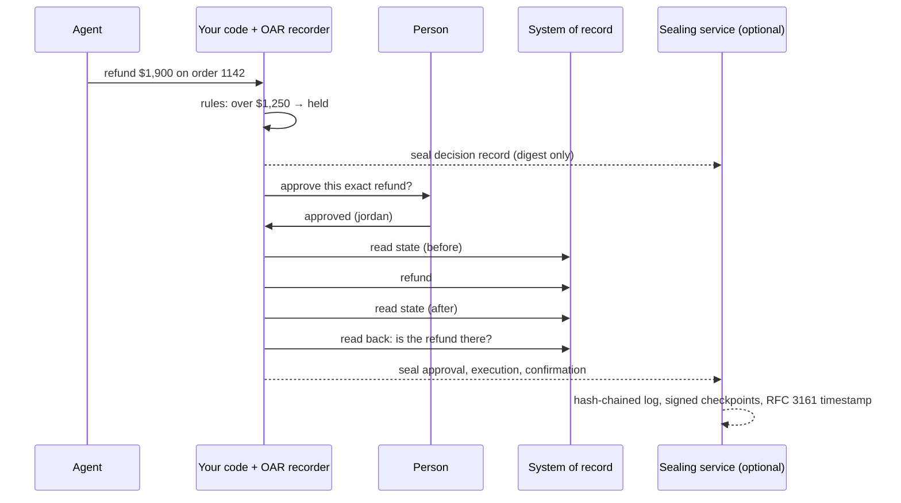

# Open Action Record (OAR)

**Your agent says it did it. OAR proves what actually changed, and who approved it.**

[](https://github.com/openactionrecord/oar/actions/workflows/ci.yml)
[](LICENSE)
[](SPEC.md)
[](https://www.npmjs.com/package/@openactionrecord/core)
[](https://pypi.org/project/open-action-record/)

AI agents now refund customers, change orders, delete rows and deploy code. When one gets it wrong, logs tell you a tool was called. They don't tell you **whether a person approved that exact action**, **what it actually changed**, or **whether the system of record agrees**. And they were written by the system you are trying to check.

Open Action Record is an open format and toolkit for signed, verifiable records of agent actions:

- **Approval of the exact action.** When a rule holds an action, the record shows who approved it, bound to a commitment of that one action (this refund, this amount). An approval can't be reused for anything else.
- **What actually changed.** The execution record commits to the affected state before and after. A separate confirmation reads the system of record back. An agent that reports success without effect shows up as **NOT confirmed**.
- **Safe to share.** Amounts, parameters, IDs and state are salted commitments. Share a bundle with an auditor, an insurer or a customer without revealing anything, then disclose field by field.
- **Checkable by anyone, offline.** Ed25519 signatures, per-agent hash chains, an optional separate sealing service, and optional RFC 3161 timestamps from an outside authority. Three independent verifiers: TypeScript, browser (WebCrypto) and Python.
- **Adds to what you have.** Already sign tool calls with another receipt format? Point an OAR record at it with `external_ref` and add the approval and outcome evidence it lacks.

## See it in one minute

```bash
npx @openactionrecord/cli demo
```

Or try it in your browser, with nothing installed: [](https://codespaces.new/openactionrecord/oar?quickstart=1) (then run `pnpm demo`).

No account, no setup. An AI support agent at an online store takes three actions; OAR records them, the bundle verifies, an edit to it is caught, and a false success shows up:

```text
1. A customer's $1,900 order arrived damaged. The agent refunds it.
   held: over the $1,250 approval limit → Jordan, the support lead, approves
   ✔ refunded, and the payment system confirms it
2. A customer asks for 80% off. The agent tries to create the code.
   ✘ blocked: over the 20% maximum (recorded, not executed)
3. A $45 refund. The payment API answers "succeeded"… but a bug means nothing was refunded.
   ✘ the agent reported success; the read-back shows no refund. Recorded as NOT confirmed.

✔ All 8 records passed verification.  [Sealed by a separate service]

✔ refund → payments  Done, and confirmed in the system of record
    decision     Held for approval by policy:store-rules-v3 (over_approval_limit)
    approval     Approved by approver:jordan (button)
    execution    Executed; state before and after recorded
    confirmation Confirmed in the system of record

✘ refund → payments  Executed, but the system of record does NOT show it
    confirmation NOT confirmed in the system of record (outcome_missing)

Now someone edits the record to pretend the $1,900 refund never needed approval:
✘ Verification failed: Issuer signature, Seal, Checkpoint coverage, Chain check failed.
```

Or open the **[playground](https://openactionrecord.github.io/oar/)**: paste a bundle, press a tamper button, watch it fail. Nothing leaves your browser.

## Record your own agent

```bash
npm install @openactionrecord/core
```

```ts
import { createRecorder, generateSigningKey, verifyBundle } from '@openactionrecord/core';

const oar = createRecorder({ issuer: generateSigningKey('my-agent-2026'), org: 'acme', agent: 'support-bot' });

const out = await oar.run({
  type: 'refund',
  target: 'stripe',
  params: { order: '1142', amountCents: 190_000 },            // committed, never written in clear
  check: (p) => (Number(p.amountCents) > 125_000 ? { result: 'held', reasons: ['over_approval_limit'] } : { result: 'allowed' }),
  approve: async () => ({ approver: 'jordan', approved: await askOnSlack() }),
  readState: () => getOrderState('1142'),                       // read before and after
  execute: () => stripe.refunds.create({ payment_intent: pi, amount: 190_000 }),
  targetRef: (refund) => refund.id,
  confirm: async (refund) => (await stripe.refunds.retrieve(refund.id)).status === 'succeeded',
});

const bundle = await oar.bundle();                                // discloses nothing by default
verifyBundle(bundle).result;                                      // "pass"
```

**Python:** `pip install open-action-record`, then the same thing with `Recorder(...).run(...)` (sync or async). See [python/](python).

**Hermes Agent:** `hermes plugins install openactionrecord/oar/integrations/hermes --enable` records every approval decision (who or what approved, on which surface, and whether the call then succeeded) as verifiable records, without writing commands in clear. See [integrations/hermes](integrations/hermes).

Every path is recorded: allowed, held, approved, rejected, denied, failed, confirmed and not confirmed. Errors from `execute` are recorded, then re-thrown. Prefer explicit steps? Use `oar.decide()`, `oar.approve()`, `oar.execute()` and `oar.confirm()`.

Runnable examples, all tested in CI (from a clone: `pnpm install && pnpm build`, then `npx tsx examples/quickstart.ts`):

| Example | Shows |
|---|---|
| [`examples/quickstart.ts`](examples/quickstart.ts) | A refund end to end, written to `evidence.json` |
| [`examples/tool-wrapper.ts`](examples/tool-wrapper.ts) | Wrap any tool (MCP handlers, OpenAI Agents SDK, LangChain) once; every call is recorded |
| [`examples/sealer-server.ts`](examples/sealer-server.ts) | A separate sealing service over HTTP, so the issuer can't rewrite its own history |
| [`examples/add-to-another-receipt.ts`](examples/add-to-another-receipt.ts) | Add approval and outcome evidence to a receipt in another format |

## Verify a bundle

```bash
npx @openactionrecord/cli verify evidence.json --cross-check   # reference verifier + independent WebCrypto verifier
npx @openactionrecord/cli html evidence.json                    # a self-contained page that verifies offline
pip install open-action-record && oar-verify evidence.json     # Python
```

Pass `--keys` with the key sets the issuer and sealing service publish (at `/.well-known/aar-keys.json`) to rule out a substituted bundle.

## How it works



Each record is signed by the issuer and links to the agent's previous record. A sealing service, run separately with its own key, countersigns each record's digest and signs checkpoints over its log. An outside timestamp authority can timestamp those checkpoints. Every verifier reports the **evidence level** it reached:

| Level | What it means |
|---|---|
| Issuer-signed | Any change to a record shows. The issuer could still rewrite its own history. |
| Sealed | Also countersigned by a separate sealing service and covered by its hash-chained log. |
| Timestamped | Sealed, and an outside authority timestamped the checkpoint: nobody can change, delete or backdate the record without it showing. |

The full format is in **[SPEC.md](SPEC.md)**.

## How OAR compares

| | Application logs | Tool-call receipts | **Open Action Record** |
|---|---|---|---|
| Tamper-evident | No | Yes | Yes, plus optional separate sealing and outside timestamps |
| Records the rule decision | Sometimes | Often | Yes, with the rules' digest |
| Approval bound to the exact action | No | Rarely | Yes (button or passkey) |
| State before and after the change | No | No | Yes, as commitments |
| Confirmation read back from the system of record | No | No | Yes; false success shows as NOT confirmed |
| Safe to share without personal data | No | Varies | Yes: salted commitments, selective disclosure |
| Verify offline, in a browser | No | Varies | Yes, three independent verifiers |

## Packages

| Package | |
|---|---|
| [`@openactionrecord/core`](packages/core) | Write records (`createRecorder`), run a sealing service, verify, summarise. Node.js 20+. |
| [`@openactionrecord/cli`](packages/cli) | `oar demo`, `oar verify`, `oar inspect`, `oar html`, `oar keygen` |
| [`open-action-record`](python) | Python: write and verify records, `oar-verify`, and the Hermes Agent plugin |
| [Playground](packages/web) | A static page that verifies bundles in the browser |
| [Test vectors](vectors) | Every verifier must pass them. They include records written by the first implementation. |

## Roadmap

- More ready-made adapters: MCP SDK middleware, OpenAI Agents SDK, LangChain, Vercel AI SDK, Claude Code hooks (Hermes Agent is done)
- Outcome readers for Stripe, Shopify and Postgres
- COSE encoding and a SCITT registration profile
- Publishing checkpoints to a public transparency log

Want one of these sooner, or something else? [Open an issue](https://github.com/openactionrecord/oar/issues).

## FAQ

**Is OAR a standard?** It's an open format with a public specification, free to implement. It isn't an industry standard. Its approval and outcome evidence is designed to be added to other agent receipt formats, and we plan to propose it for discussion at the IETF.

**Do I need a service or an account?** No. Everything here runs locally. The sealing service is a small piece you can run yourself ([example](examples/sealer-server.ts)). Outside timestamps use any RFC 3161 authority; DigiCert's is free.

**Does it store personal data?** Records hold salted commitments, never values. You keep the salts and disclose values only to the people who need them.

**Who maintains it?** OAR is maintained by [Tridris](https://tridris.com), which uses it in its product. The format and these tools are free to use without Tridris. Contributions are welcome; see [CONTRIBUTING.md](CONTRIBUTING.md).

## Contributing, security, licence

- [CONTRIBUTING.md](CONTRIBUTING.md): development setup and how to propose changes.
- [SECURITY.md](SECURITY.md): report vulnerabilities privately.
- Code: [Apache-2.0](LICENSE). Specification: [CC BY 4.0](LICENSE-SPEC).
